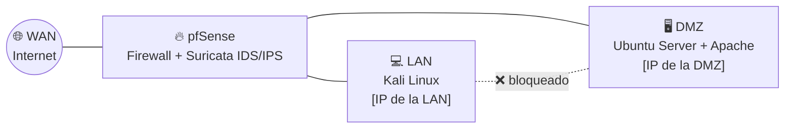

# 🛡️ Infraestructura de Red Segura con pfSense + Suricata IDS/IPS

> Proyecto Final del CFGS en Administración de Sistemas Informáticos en Red (ASIR)

Diseño e implementación de una infraestructura de seguridad perimetral para una **PYME de 20 empleados**: red segmentada en **WAN, LAN y DMZ** con firewall **pfSense**, detección y bloqueo de ataques en tiempo real con **Suricata IDS/IPS**, y validación mediante **ataques controlados desde Kali Linux**.

---

## 🗺️ Topología de red

| Máquina | Rol | Red |
| --- | --- | --- |
| pfSense CE | Firewall perimetral + IDS/IPS | WAN / LAN / DMZ |
| Ubuntu Server | Servidor web (Apache) expuesto | DMZ |
| Kali Linux | Equipo atacante para las pruebas | LAN |

---

## 🧱 Principios de seguridad aplicados

- **Segmentación de red:** LAN y DMZ aisladas entre sí.
- **Mínimo privilegio:** cada equipo solo accede a lo que necesita.
- **Defensa en profundidad:** si el firewall no lo para, Suricata lo detecta.
- **Política deny-all:** todo bloqueado por defecto, solo se permite lo necesario.

---

## 🔒 Hardening de pfSense

- Panel web movido a un puerto no estándar y acceso **solo por HTTPS**
- **UPnP desactivado** y servicios innecesarios deshabilitados
- Protección contra **fuerza bruta** en el acceso de administración
- [Añade aquí otras medidas que aplicaste]

### Reglas de firewall

| Origen | Destino | Acción | Motivo |
| --- | --- | --- | --- |
| LAN | Internet (HTTP/HTTPS) | ✅ Permitir | Navegación de los empleados |
| LAN | DMZ | ❌ Bloquear | Aislar la red interna del servidor expuesto |
| DMZ | LAN | ❌ Bloquear | Si el servidor cae, el atacante no llega a la LAN |
| WAN | Cualquiera | ❌ Bloquear | Política por defecto |

---

## 🚨 Suricata IDS/IPS

- Monitorización de **las tres interfaces** (WAN, LAN y DMZ)
- Conjuntos de reglas **ETOpen (Emerging Threats)** y **Snort GPLv2**
- **Reglas personalizadas** en [`suricata/custom.rules`](suricata/custom.rules):

| SID | Detecta | Prioridad |
| --- | --- | --- |
| 9000001 | Tráfico ICMP (ping) | 🟢 Pri 3 · Baja |
| 9000002 | Escaneo de puertos TCP | 🟡 Pri 2 · Media |
| 9000003 | Fuerza bruta SSH | 🔴 Pri 1 · Crítica |

- **Modo IPS** activado con *Block Offenders* y *Kill States*: bloqueo automático del atacante
- **Reglas de supresión** para reducir falsos positivos

---

## ⚔️ Pruebas de seguridad (ataques controlados desde Kali)

| Ataque | Herramienta | Resultado |
| --- | --- | --- |
| Escaneo de puertos y servicios | Nmap (`-sS`, `-sV`, `-A`) | ✅ Detectado por Suricata |
| Escaneo de vulnerabilidades web | Nikto | ✅ Detectado |
| Fuerza bruta SSH | Hydra | ✅ Detectado y bloqueado (Pri 1) |
| Denegación de servicio (SYN, UDP, ICMP flood) | hping3 | ✅ Detectado y bloqueado |

> ⚠️ Todas las pruebas se realizaron en un laboratorio aislado y propio, con fines educativos.

---

## 🧩 Problemas reales y cómo los resolví

| Problema | Solución |
| --- | --- |
| Me quedé sin acceso al panel de pfSense por una regla mal configurada | Acceso por consola y desactivación temporal del filtrado con `pfctl -d` |
| Suricata no detectaba el tráfico en el modo NAT de VirtualBox | Creación de reglas personalizadas en `custom.rules` |
| Ubuntu Server sin resolución DNS | [Explica aquí cómo lo solucionaste] |

---

## 📚 Marco normativo

RGPD · LOPDGDD 3/2018 · ENS (Real Decreto 311/2022) · ISO/IEC 27001 · ISO/IEC 27002

## 📄 Documentación

La memoria completa y los manuales de instalación, administración y usuario están en [`docs/`](docs/).

---

<b>Pedro Fernández</b> · <a href="https://github.com/p3drosec">@p3drosec</a>

